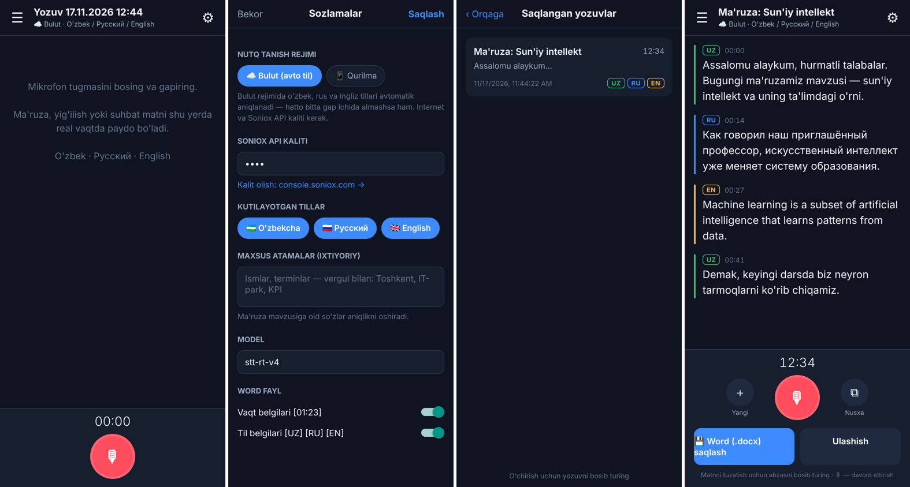

# Ovoz → Matn

Ma'ruza, yig'ilish va suhbatlardagi nutqni **real vaqt rejimida** matnga aylantiruvchi mobil ilova (Android / iOS).
U **o'zbek, rus va ingliz** tillarini **avtomatik aniqlaydi** (til gap ichida almashsa ham). Tayyor matnni **Word (.docx)** faylga saqlash mumkin.



## Imkoniyatlar

| | |
|---|---|
| 🎙 Real vaqt rejimi | So'zlar aytilishi bilan ekranda paydo bo'ladi. Taxminiy qism kulrang, tasdiqlangani oq rangda |
| 🌐 Tilni avto aniqlash | UZ / RU / EN. Har bir abzas til belgisi va rangi bilan ajratiladi |
| ⏱ Vaqt belgilari | Har bir abzas qachon aytilganini ko'rsatadi (`[12:34]`) |
| ⏸ Pauza / davom ettirish | Tanaffusda pauza qilish yoki saqlangan yozuvga yangi qism qo'shish mumkin |
| 🔁 Avtomatik qayta ulanish | Internet uzilsa, yozuv to'xtamaydi: ilova serverga qayta ulanadi |
| 📱 Fon rejimi | Ekran o'chganda ham yozish davom etadi (Android'da bildirishnoma ko'rinadi) |
| ✏️ Tahrirlash | Abzasni bosib turib matnni tuzatish mumkin |
| 💾 Word fayl | `.docx` faylga sarlavha, sana, davomiylik, tillar, vaqt va til belgilari bilan saqlanadi |
| 📤 Ulashish | Telegram, Google Drive, Email, "Fayllar"ga yuborish mumkin |
| 🗂 Tarix | Barcha yozuvlar telefonda avtomatik saqlanadi |

## Nutq tanish rejimlari

1. **☁️ Bulut (tavsiya etiladi).** [Soniox](https://soniox.com) real-time API ishlatiladi. U o'zbek tilini yaxshi biladi va tilni har bir so'z darajasida aniqlaydi. Internet hamda API kalit kerak: kalitni [console.soniox.com](https://console.soniox.com) saytida olib, *Sozlamalar → Soniox API kaliti* maydoniga kiritasiz.
2. **📱 Qurilma.** Telefonning o'z nutq tanish tizimi (Google / Apple) ishlatiladi. Kalit kerak emas, lekin til avtomatik aniqlanmaydi.
   Buning o'rniga asosiy ekranda **Til: 🇺🇿 UZ · 🇷🇺 RU · 🇬🇧 EN** tugmalari bor. Ma'ruzachi tilni almashtirganda kerakli tugmani bosasiz: yozish to'xtamaydi,
   aytilgan gap eski til bilan saqlanadi, yangi gap esa yangi abzasda, to'g'ri til belgisi bilan boshlanadi. Oxirgi tanlangan til eslab qolinadi.

## O'rnatish va ishga tushirish

Ilovada native modullar (mikrofon oqimi, nutq tanish) bor, shuning uchun **Expo Go'da ishlamaydi**. Development build yoki APK kerak.

```bash
cd ovoz-matn
npm install

# Android APK yig'ish (bulutda, Android Studio shart emas)
npm install -g eas-cli
eas login
eas build -p android --profile preview      # → yuklab olinadigan .apk

# iOS
eas build -p ios --profile preview

# Lokal ishlab chiqish (Android Studio / Xcode o'rnatilgan bo'lsa)
npx expo run:android
npx expo run:ios
```

## Tekshiruvlar

```bash
npm run typecheck   # TypeScript
npm test            # segmentlash, Soniox protokoli, Word fayl yaratish
```

`docs/namuna.docx` testlar yaratgan namunaviy Word fayl.

## Tuzilishi

```
App.tsx                         ekranlar o'rtasida o'tish
src/lib/transcript.ts           tokenlarni til bo'yicha abzaslarga yig'ish (sof mantiq)
src/lib/soniox.ts               Soniox WebSocket klienti (bufer, keepalive, xatolar)
src/lib/useTranscriber.ts       mikrofon → server → ekran; pauza, qayta ulanish, qurilma rejimi
src/lib/docx.ts                 Word hujjat yaratish
src/lib/exportFile.ts           faylni saqlash (Android: papka tanlash) va ulashish
src/lib/storage.ts              sozlamalar va yozuvlar tarixi
src/screens/*                   Yozish, Sozlamalar, Tarix ekranlari
tests/logic.test.ts             testlar
```

## Xavfsizlik bo'yicha eslatma

API kalit faqat telefonda (AsyncStorage) saqlanadi va to'g'ridan-to'g'ri Soniox'ga yuboriladi.
Ilovani keng tarqatmoqchi bo'lsangiz, kalitni ilovaga joylamang. Uning o'rniga o'z serveringizda Soniox'ning *temporary API key* endpointi orqali vaqtinchalik kalit beradigan kichik backend yarating.
